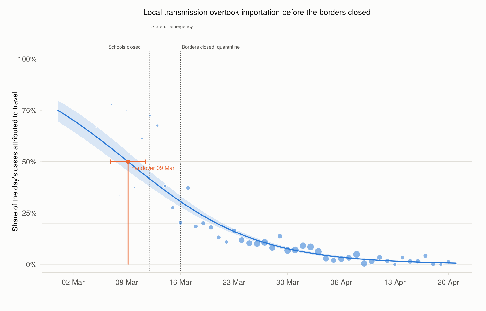
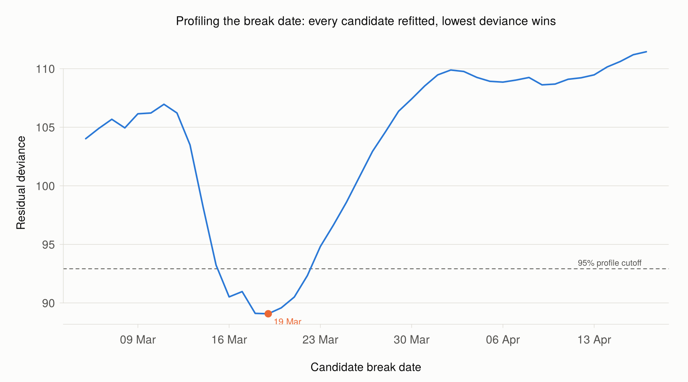
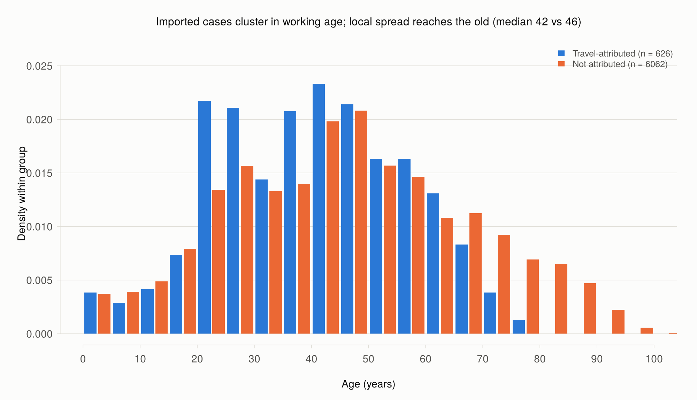
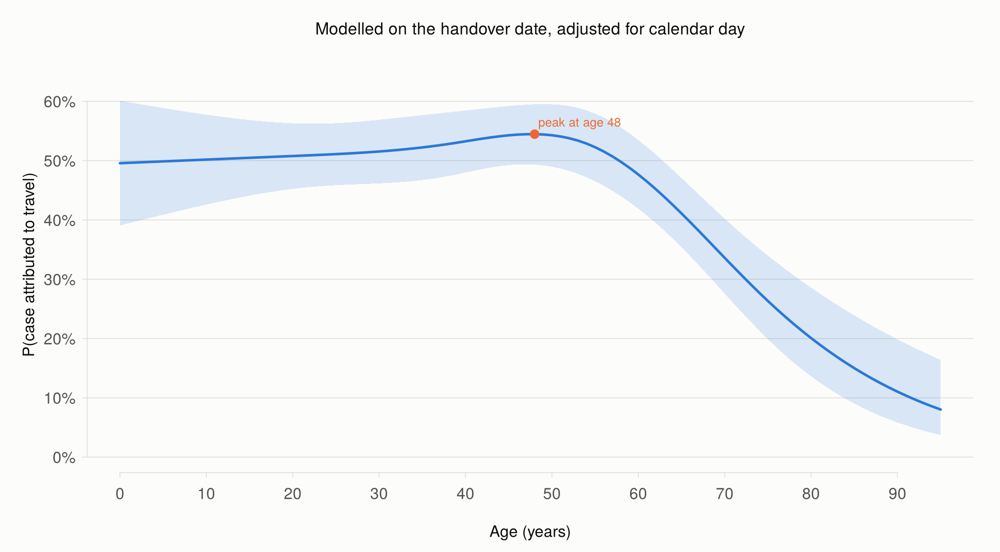
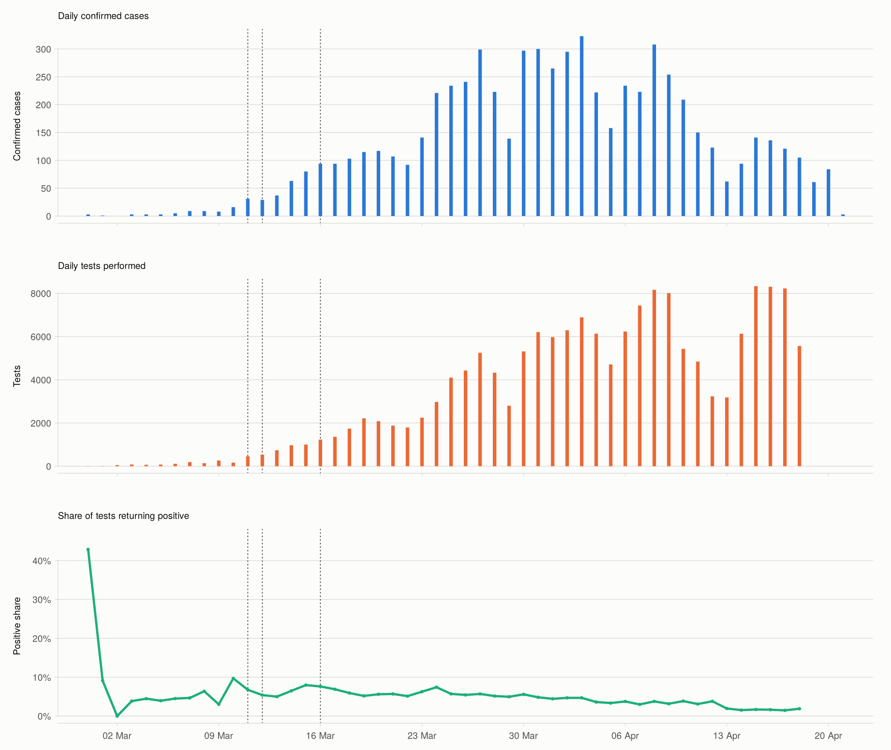
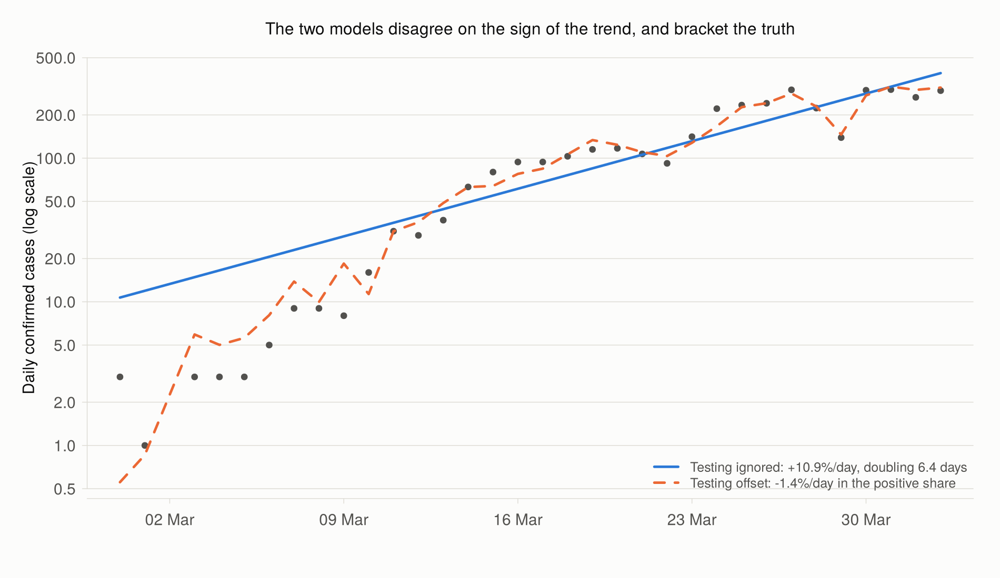
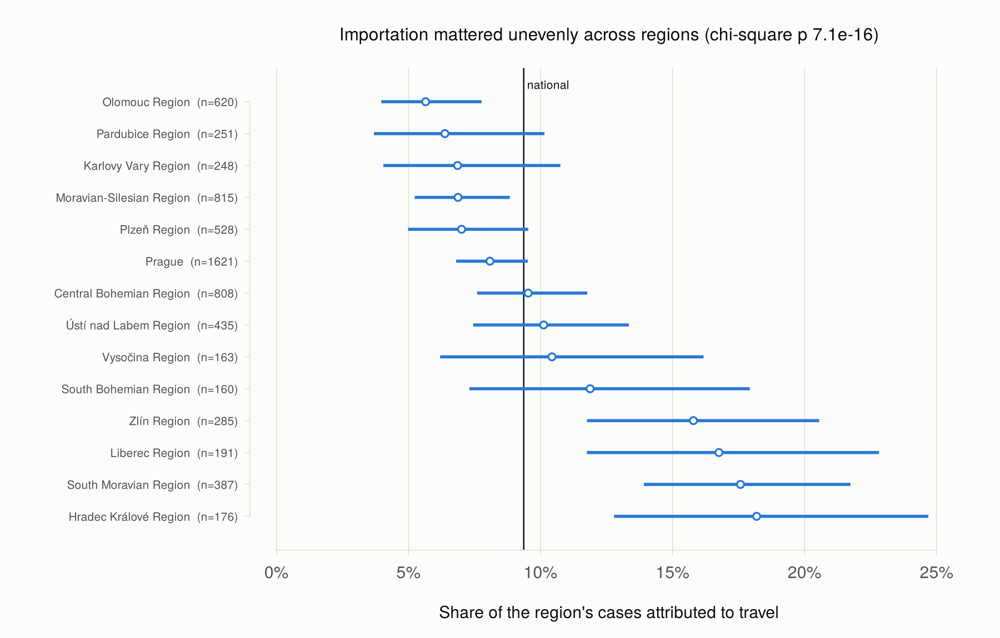
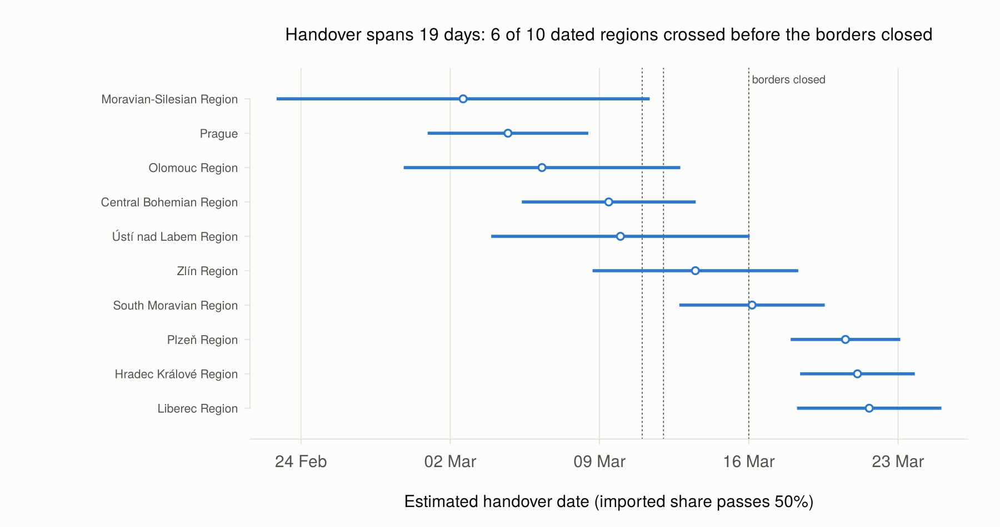

# When did Czechia's epidemic stop being imported?

The first wave of SARS-CoV-2 in Czechia arrived with returning skiers: Austria and Italy together account for **52% of all travel-attributed cases**. The policy response was built around that fact, and the borders were sealed on 16 March 2020.

This repository dates the moment the epidemic stopped depending on travel, and finds that it happened **a week before the borders closed**.

Everything runs on base R. No CRAN downloads, no `tidyverse`.

```bash
Rscript run_all.R     # ~5 seconds, writes 8 figures and 8 tables
```

**Data:** 6,688 individually reported cases, 29 February to 21 April 2020, with age, sex, region, a travel-attribution flag and country of exposure, plus daily national testing counts. Obtained from the Kaggle dataset [COVID-19 in Czechia: person-level data](https://www.kaggle.com/datasets/samusram/covid19-in-czechia-personlevel-data) (CC0); originally published by the Czech Ministry of Health.

---

## 1. The handover: 9 March, seven days before the borders closed



Each day's cases split into those contact tracing attributed to travel and those it did not. Modelling that split as binomial in time turns a question usually answered by eye into a dated estimate:

```
logit P(imported on day t) = b0 + b1·t        handover at t* = −b0/b1
```

| Quantity | Estimate |
|---|---|
| **Handover date (imported share falls below 50%)** | **9 March 2020** |
| 95% CI, quasi-binomial (the one to quote) | 6 – 11 March |
| 95% CI, delta method | 7 – 10 March |
| 95% CI, parametric bootstrap (4,000 reps) | 7 – 10 March |
| Odds of travel attribution | halve every **5.8 days** |
| Borders closed, nationwide quarantine | 16 March, **7 days later** |
| Schools closed | 11 March, 2 days later |

Three methods, three intervals, all ending before 16 March. Day-to-day scatter is about 2.2 times what binomial sampling allows — cases arrive in clusters and tracing effort varied — so the quasi-binomial interval is the honest width, and it still clears the border closure by five days.

### Was the decline a straight line in the log-odds?



No. A break date is not identified by differentiating the likelihood, so `02_crossover.R` profiles it: refit the segmented model at every candidate date and keep the lowest deviance.

The break lands on **19 March** (profile 95% interval 16–22 March), three days after the borders closed, and the decline **slows** rather than accelerating: −0.212 per day before, −0.097 after. The deviance drop of 22.4 is large, though the usual chi-square p-value is anti-conservative here because the break date is not estimated under the null, so the deviance drop itself is the honest statistic.

A plausible reading is that the steep early fall was the travel channel being shut, and the slower later fall is the residue of repatriations and returning residents against a local epidemic that was by then much larger. The data support the timing; they do not establish the mechanism.

---

## 2. Imported and local cases are different people



| | Travel-attributed | Not attributed |
|---|---|---|
| n | 626 | 6,062 |
| Median age | 42 | 46 |
| IQR | 28 – 53 | 31 – 62 |
| **Aged 65+** | **8.3%** | **21.8%** |

The shift in median age is **5.0 years** (Hodges–Lehmann, 95% CI 4.0 to 7.0), and the distributions differ in shape as well as location (Kolmogorov–Smirnov D = 0.141, p = 2.8e-10).



Modelling travel attribution on age with a natural cubic spline, adjusted for calendar day because importation and age composition both changed over the window, the probability peaks at **age 48** and falls to roughly half that by 75.

This is what a travel-seeded epidemic handing over to community transmission looks like from the inside. Skiing selects the middle-aged; households and care settings do not.

---

## 3. How fast was it really growing? The honest answer is a range



Czech testing rose from **7 tests a day to 6,291**, a factor of 899, over the growth phase. A case curve read at face value credits the virus with growth that belongs to the laboratory.

Two quasi-Poisson models of the same counts, differing only in whether testing enters as an offset:

| Model | Growth rate/day | Doubling time |
|---|---|---|
| Cases, testing ignored | **+0.109** (95% CI 0.093 to 0.125) | 6.4 days |
| Positive share, testing offset | **−0.014** (95% CI −0.022 to −0.007) | — |



**The two models disagree on the sign of the trend.** Taken literally the second says the epidemic shrank throughout March, which is not credible. The reason is that the offset assumes a test on 29 February and a test on 2 April are the same instrument. They are not: the earliest tests went almost exclusively to symptomatic people returning from Italy and Austria, which is why 7 tests produced 3 cases and positivity started at 42.9% and ended at 4.7%.

So neither figure is the growth rate. They **bracket** it. Testing ignored is an upper bound, testing offset is a lower bound, and the truth lies between. Restricting to days with at least 100 tests leaves the picture unchanged (+0.101 against −0.015), so the reversal is not an artefact of the first week's single-digit denominators.

I have left this unresolved rather than picking the flattering number. Resolving it needs test-targeting data this file does not contain.

---

## 4. One country, fourteen epidemics



The travel-attributed share runs from **5.6% in Olomouc to 18.2% in Hradec Králové**, far more spread than chance allows (chi-square 101.9 on 13 df, p = 7.1e-16).



Fitting the handover model separately in the ten regions with enough imported cases to support a slope:

- Earliest: **Moravian-Silesian, 2 March**
- Latest: **Liberec, 21 March**
- Spread: **19 days**
- **6 of 10 crossed over before the borders closed; 4 did not.**

The national date of 9 March is an average over regions that were weeks apart. Any policy evaluation that treats the country as one epidemic is averaging away the thing it should be measuring.

---

## Limitations

These constrain every claim above.

- **The travel flag is an attribution, not ground truth.** It records what contact tracing concluded, and tracing capacity was under strain exactly when case counts were growing fastest. Unrecognised importations sit in the unattributed group, which biases the imported share downwards and pushes the estimated handover **earlier** than the truth. The 9 March estimate should be read as the early end of a plausible range.
- **Growth rate is bracketed, not estimated.** See section 3. Nothing here is a reproduction number, and none of these quantities should be read as R0 or Rt.
- **Report date is not infection date.** No deconvolution for incubation or reporting delay was attempted, so every date here is a reporting date and the underlying epidemiological events happened roughly one to two weeks earlier.
- **Four regions could not be dated**, having fewer than 20 imported cases. They are the smallest, so the regional spread above may understate the true range.
- **No denominators by region or age.** All regional and age comparisons are of case composition, not of rates in the population.
- **This is an ecological analysis** of surveillance data from the period when surveillance was least reliable. The policy dates are reference lines on figures and are never model inputs; nothing here identifies a causal effect of any intervention.
- The line list totals 1.7% more cases than the separately published daily counts over the overlapping window, consistent with later reporting revisions. The discrepancy is reported in `01_clean.R` rather than reconciled.

## Repository layout

```
R/00_setup.R                     paths, UTF-8 locale, plotting defaults
R/01_clean.R                     line list, daily series, region labels
R/02_crossover.R                 handover date, bootstrap, changepoint profile
R/03_age_structure.R             age comparison and spline model
R/04_testing_adjusted_growth.R   growth with and without a testing offset
R/05_regional.R                  regional shares and regional handover dates
run_all.R                        reproduces everything
outputs/figures/                 8 PNGs
outputs/tables/                  8 CSVs
```

`00_setup.R` sets a UTF-8 locale before plotting. Without it, R under a C locale (common in containers and CI runners) silently renders *Plzeň* as *Plze..*.

Figure colours were checked for colour-vision-deficiency separation before use, and every figure has a corresponding CSV in `outputs/tables/`, so no result depends on reading a colour.

## Sources for the policy dates

Policy dates are used only as reference lines. State of emergency 12 March 2020; schools closed 11 March; borders closed and nationwide quarantine from 16 March. See [expats.cz, COVID-19 in the Czech Republic: a timeline](https://www.expats.cz/czech-news/article/covid-19-in-the-czech-republic-a-timeline) and [Al Jazeera, 13 March 2020](https://www.aljazeera.com/news/2020/3/13/czechs-close-borders-from-march-16-over-coronavirus-spread).

## Licence

Code is MIT (see `LICENSE`). The data files in `data/raw/` come from a Kaggle dataset released under CC0 (public domain) and are included for reproducibility.
